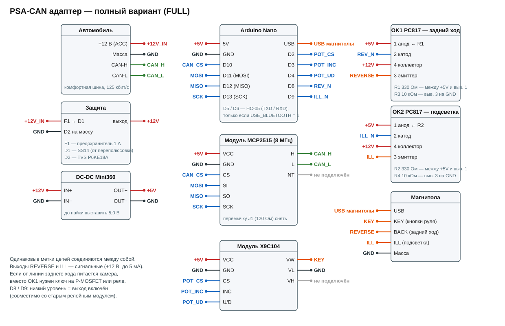
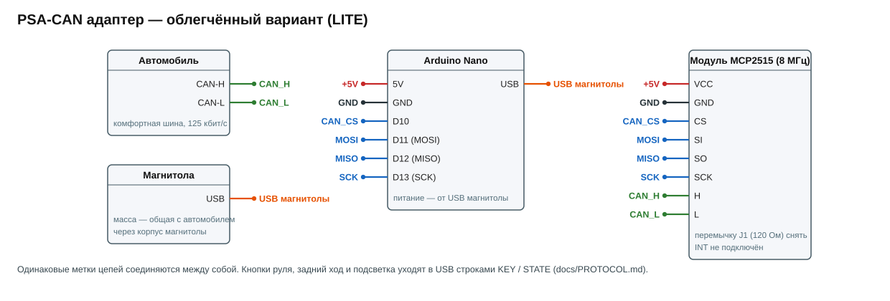
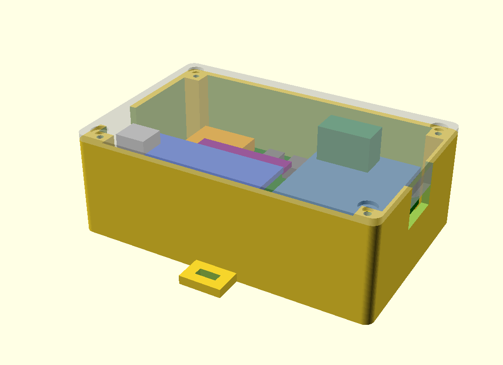
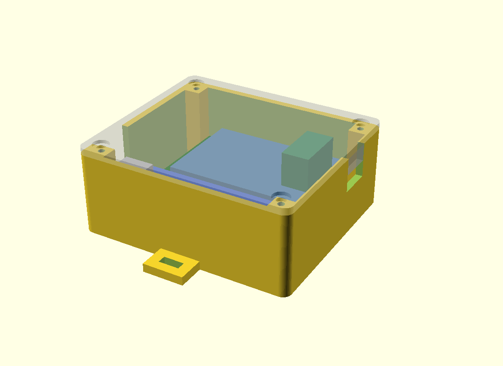

# Железо

Два варианта одного адаптера. Прошивка общая, вариант выбирается в `PsaCanAdapter/Config.h` (`VARIANT`).

| | FULL — полный | LITE — облегчённый |
|---|---|---|
| Кнопки руля | USB (`KEY …`) и провод KEY магнитолы | только USB |
| Задний ход, подсветка | USB (`STATE …`) и выходы +12 В | только USB |
| Питание | +12 В автомобиля через DC-DC | USB магнитолы |
| Провода в машину | +12 В, масса, CAN-H, CAN-L, KEY, BACK, ILL, USB | CAN-H, CAN-L, USB |
| Корпус | 84,6 × 54,8 × 29,6 мм | 62,6 × 54,8 × 25,6 мм |

LITE работает, только пока магнитола подаёт питание на USB, и требует приложения (PSADisplay), которое
обрабатывает строки `KEY` и `STATE`. FULL работает и без приложения.

## FULL

| Поз. | Деталь | Кол-во | Примечание |
|---|---|---|---|
| | Arduino Nano (ATmega328P) | 1 | в панельках PLS/PBS |
| | Модуль MCP2515 + TJA1050, кварц 8 МГц | 1 | перемычку J1 (терминатор 120 Ом) снять |
| | DC-DC Mini360 (MP2307) | 1 | вместо LM2596; выставить 5,0 В до подключения |
| | Модуль X9C104 | 1 | провод KEY |
| OK1, OK2 | Оптопара PC817 | 2 | вместо релейного модуля |
| R1, R2 | Резистор 330 Ом | 2 | ток светодиода оптопары ≈ 10 мА |
| R3, R4 | Резистор 10 кОм | 2 | подтяжка выхода к массе |
| F1 | Предохранитель 1 А (держатель в разрыв провода) | 1 | |
| D1 | Диод Шоттки SS14 / 1N5819 | 1 | защита от переполюсовки |
| D2 | TVS P6KE18A | 1 | защита от выбросов бортсети |
| | Макетная плата 50 × 70 мм | 1 | |

Что убрано по сравнению со старой схемой: релейный модуль (выходы BACK и ILL — сигнальные, реле им не нужно),
HC-05 (настройка идёт по USB), LM2596 (заменён втрое меньшим Mini360), беспаечная макетка.

Выход оптопары отдаёт до 5 мА. Если от линии заднего хода питается сама камера, вместо OK1 нужен ключ на
P-MOSFET или реле.

Раскладка платы, под которую сделан корпус (X — вдоль длинной стороны, от торца с USB):

- Nano — вдоль длинной стороны, ось в 14,5 мм от края платы, торец с USB выступает за край на 3 мм;
- MCP2515 — поперёк, у противоположного торца (X 42…70 мм), клеммником к середине платы;
- Mini360, оптопары, X9C104 (на ребре) — в оставшемся поле 40 × 24 мм рядом с Nano;
- углы платы 5 × 5 мм свободны — в них упираются стойки крышки.

## LITE

| Деталь | Кол-во | Примечание |
|---|---|---|
| Arduino Nano (ATmega328P) | 1 | впаяна в плату |
| Модуль MCP2515 + TJA1050, кварц 8 МГц | 1 | перемычку J1 снять |
| Макетная плата 50 × 48 мм | 1 | 50 × 70, обрезанная по длине |

Раскладка: Nano вдоль стороны 48 мм (ось в 10,5 мм от края, USB выступает на 3 мм), MCP2515 рядом, параллельно
(X 5…45 мм), клеммником к торцу с выводом проводов. Свободны углы у вывода проводов со стороны Nano и у USB со
стороны MCP2515 — там стойки крышки.

## Корпус

Исходник — [`case/case.scad`](../case/case.scad) (OpenSCAD), параметр `variant`. Готовые модели:

| Вариант | Основание | Крышка |
|---|---|---|
| FULL | `case/base-full.stl` | `case/lid-full.stl` |
| LITE | `case/base-lite.stl` | `case/lid-lite.stl` |

- Плата лежит на полках, с торцов упирается в бобышки, сверху прижата стойками крышки — отдельного крепежа платы нет.
- Крышка — четыре самореза 2,2 × 9,5 мм (или M2.5 × 8).
- Печать без поддержек: основание дном вниз, крышка пластиной вниз (в STL уже так). Слой 0,2 мм, PETG или ABS —
  за панелью летом жарко, PLA может повести.
- Окно USB рассчитано на Nano в панельках (FULL) или впаянную (LITE); при другой посадке меняется `usb_z`.
- Ушки по бокам — под стяжки; отключаются параметром `ears`.

Размеры модулей взяты типовые, с реальными платами корпус не примерялся — перед печатью стоит сверить
`usb_y`, `usb_z` и высоту `headroom` со своей сборкой.

Схемы генерируются скриптом: `python hardware/gen_schematic.py`.
